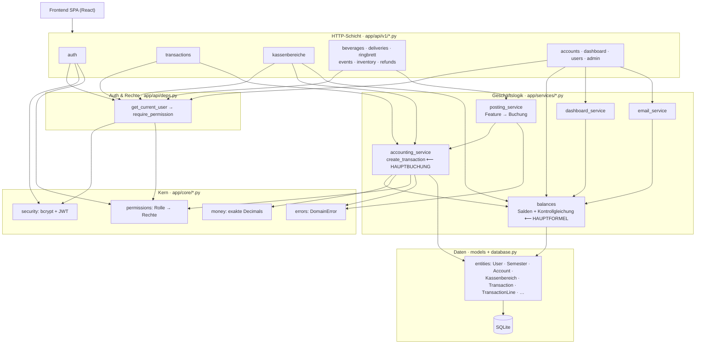
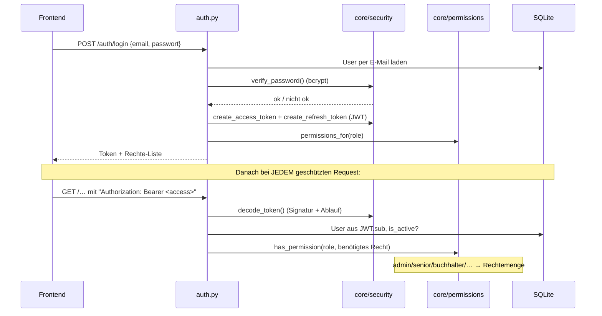
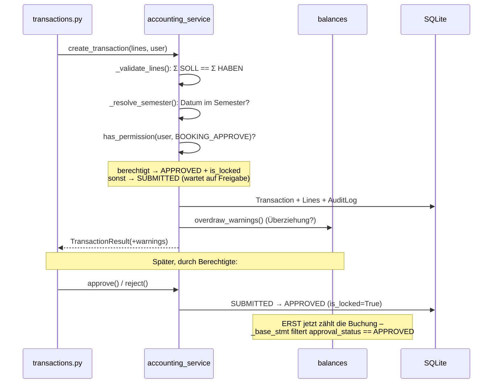

# Backend-Architektur – Diagramme (Mermaid)

> Diese Datei enthält Mermaid-Diagramme. Sie werden direkt auf GitHub gerendert.
> In Editoren ohne Mermaid-Unterstützung: siehe `docs/ARCHITEKTUR.md`
> (gleicher Inhalt als reine ASCII-Diagramme).

Legende: `★` = kritische Stelle („Hauptformel" / „Hauptbuchung").

---

## 1. Schichten & Abhängigkeiten

---

## 2. Authentifizierung & Rechte

---

## 3. Buchung inkl. Freigabe-Workflow

---

## 4. Wo genau was passiert (mit Fundstelle)

| Thema                          | Datei : Zeile                                   | Rolle                                            |
| ------------------------------ | ----------------------------------------------- | ------------------------------------------------ |
| Passwort-Hash (bcrypt)         | `core/security.py:12` / `:16`                   | `hash_password` / `verify_password`              |
| JWT erzeugen/prüfen            | `core/security.py:23`–`46`                      | access-/refresh-Token, `decode_token`            |
| Token → User                   | `api/deps.py:17`                                | `get_current_user`                               |
| Recht erzwingen                | `api/deps.py:32` + `core/permissions.py:69`     | `require_permission` / `has_permission`          |
| Rollen→Rechte-Matrix           | `core/permissions.py:37`                        | `ROLE_PERMISSIONS`                               |
| ★ Hauptbuchung + Invariante    | `services/accounting_service.py:99`             | `create_transaction` (einziger Buchungsweg)      |
| ★ Buchung ausgeglichen?        | `services/accounting_service.py:71`             | `_validate_lines`: **Σ SOLL = Σ HABEN**          |
| Semester-/Datumsprüfung        | `services/accounting_service.py:52`             | `_resolve_semester`                              |
| Freigabe-Workflow              | `accounting_service.py:259` (`approve`), `:275` (`reject`) | Status `ApprovalStatus` (`enums.py:117`) |
| Storno (gespiegelte Buchung)   | `accounting_service.py:216`                     | `stornate`                                       |
| Feature → Buchung              | `services/posting_service.py:66/115/169/211`    | Ringbrett / Event / Lieferung / Erstattung       |
| ★ Hauptformel (Kontrollgl.)    | `services/balances.py:125`                      | `Σ Kassenbereiche = Liquidität + Ford. − Verb.`  |
| Nur freigegebene zählen        | `services/balances.py:47`                       | `_base_stmt` → `approval_status == APPROVED`     |
| Exaktes Geld                   | `core/money.py:21` / `:33`                      | `to_decimal` / `MoneyType` (skalierte Ints)      |
| DB-Session (commit/rollback)   | `database.py:23`                                | `get_db` pro Request                             |
| Audit-Log                      | `accounting_service.py:335`                     | `_audit`                                         |
| E-Mail-Verrechnung             | `services/email_service.py` ↔ `api/v1/users.py:41` | Ausstand je Mitglied                          |
