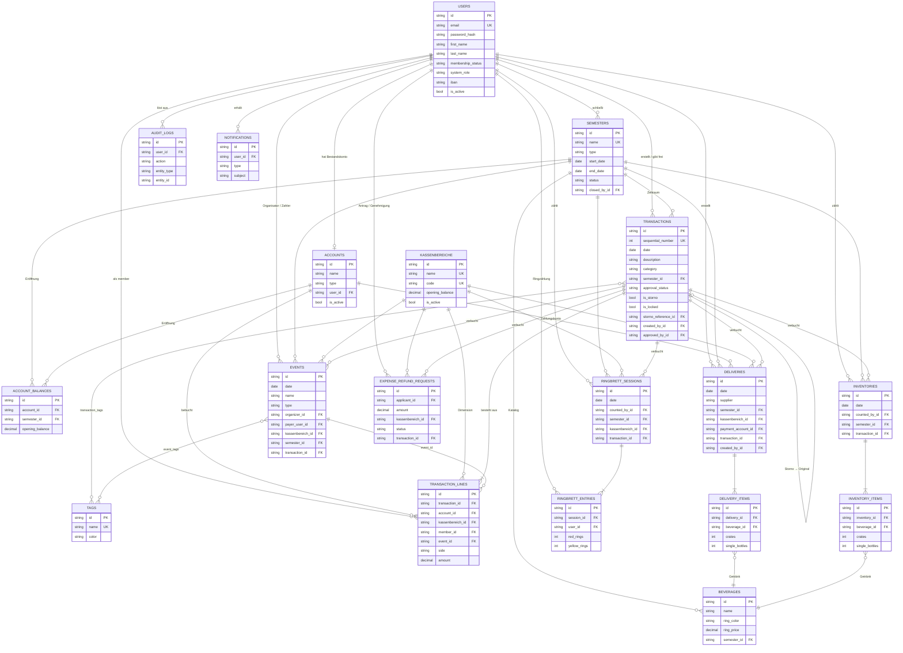

# Datenmodell – Diagramm (Mermaid)

> Entity-Relationship-Diagramm der Bierkasse7-Datenbank. Wird direkt auf GitHub
> gerendert. In Editoren ohne Mermaid-Unterstützung: siehe `docs/DATENMODELL.md`
> (gleicher Inhalt als ASCII + Spaltenreferenz).

Legende: `PK` Primärschlüssel · `FK` Fremdschlüssel · `UK` eindeutig.
`||--o{` = 1:0..n · `||--o|` = 1:0..1 · `}o--o{` = m:n.

---

## Kern-Erkenntnisse

* **Eine** Datenbank, `TRANSACTIONS` + `TRANSACTION_LINES` sind das Herz:
  jede Zeile hat genau **ein Konto** und **einen Kassenbereich** – daraus
  entstehen alle Salden.
* **Salden werden nicht gespeichert**, nur projiziert. Gespeichert sind nur
  Eröffnungswerte (`KASSENBEREICHE.opening_balance`,
  `ACCOUNT_BALANCES.opening_balance`).
* **Jedes Fachmodul** (`DELIVERIES`, `EVENTS`, `RINGBRETT_SESSIONS`,
  `INVENTORIES`, `EXPENSE_REFUND_REQUESTS`) verweist über `transaction_id` auf
  die von ihm erzeugte Buchung.
* **Storno** = neue Gegenbuchung (`storno_reference_id` → Original), kein Löschen.
* Nur `TRANSACTIONS.approval_status = approved` zählt in die Salden.
